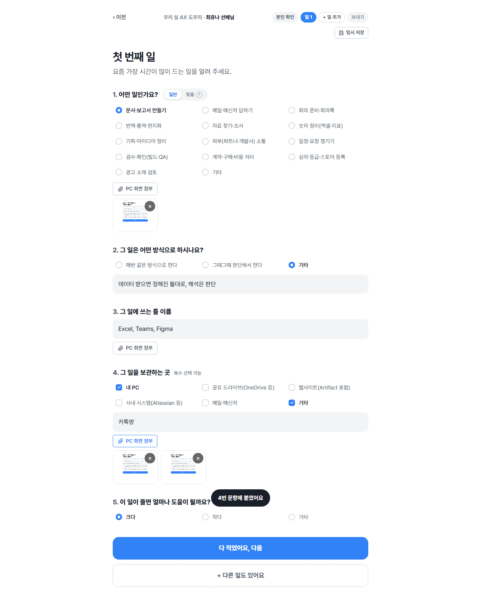
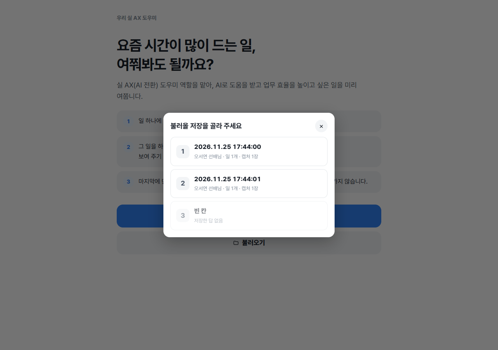

# survey-form

An agent skill (Claude Code / Codex) for building an internal survey as **one HTML file** — no server, no form service. People open the file, pick answers, attach screenshots of their PC screen, and press one button to get a ready-to-send `.eml` reply with everything attached.

> 사내 설문을 **파일 하나짜리 HTML**로 만드는 에이전트 스킬입니다. 서버·폼 서비스 없이, 받은 사람이 파일을 열어 고르고 PC 화면을 붙인 뒤 버튼 한 번이면 답이 담긴 메일(.eml)이 만들어집니다.



## What you get / 들어 있는 것

| | |
|---|---|
| 본인 확인 | 이름만 고르는 작은 목록 → 이름이 제목·답 메일·파일 이름에 한 번에 반영 |
| 고르기 위주 문항 | n×n 보기 격자, 서술은 '기타'와 툴 이름만 |
| [일반] / [맞춤] | 사람마다 미리 정리해 둔 '내 일' 보기. '?' 말풍선에 근거 자료 |
| PC 화면 첨부 | 문항별 버튼·Ctrl+V·끌어놓기, 작은 미리보기, 보내기 화면에서 크게 보기 |
| 일 여러 개 | 위 탭 '+ 일 추가'와 맨 아래 '+ 다른 일도 있어요' |
| 임시 저장 | 게임 세이브처럼 칸 3개, 칸마다 저장 시각 |
| 답 보내기 | 요약 확인 → `.eml`(X-Unsent, 스크린샷 첨부) → Outlook에서 '보내기' |
| 품질 | 라이트/다크, 휴대폰 390px, 키보드 조작 |



## Install / 설치

```bash
# Claude Code
git clone <this repo> ~/.claude/skills/survey-form
```

Then just ask: "팀원들한테 돌릴 설문 만들어줘", "업무 파악 설문 HTML로". The skill copies `assets/survey_template.html` and swaps the content (names, options, per-person suggestions, reply address, storage keys) — see `references/customize.md`.

## Layout / 구성

```
SKILL.md                  # 만드는 순서와 화면 규칙(왜 그런지 함께)
assets/survey_template.html   # 완성된 틀 — 예시 이름·예시 데이터
references/customize.md   # 갈아 끼울 곳 표(찾는 글 기준)
scripts/qa_survey.py      # Playwright(Edge)로 전체 흐름 확인
scripts/qa_slots.py       # 임시 저장 칸 확인
scripts/qa_tip.py         # '?' 말풍선 확인
```

```bash
uv run --python 3.12 --no-project --with playwright python scripts/qa_survey.py assets/survey_template.html out any.png
```

## Notes / 알아 둘 점

- Saved drafts live in the browser on that PC only (localStorage + IndexedDB). Change the storage key prefix for each survey — local HTML files share storage.
- Edge warns on `.eml` downloads (Chromium default). The template tells people to press '유지' (Keep).
- All names and data in the template are fictional examples.

> 임시 저장은 그 PC의 그 브라우저에만 남습니다. 설문마다 저장 키 접두어를 바꾸세요. 틀 안의 이름·데이터는 모두 예시입니다.
